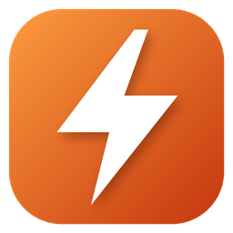

# Ferrite

A tiny, fast web browser for Windows, written in Rust. It's a ~700 KB native shell around the system's WebView2 engine (via [wry](https://github.com/tauri-apps/wry) + [tao](https://github.com/tauri-apps/tao)), so pages render with a modern engine while the browser itself stays light (~23 MB working set).



## Features

- Tabs, back/forward/reload, address bar that searches DuckDuckGo
- Bookmarks, history (with address-bar suggestions), downloads panel
- Keyboard shortcuts
- Light and dark theme follows Windows

| Keys | Action |
|---|---|
| Ctrl+T / Ctrl+W | New / close tab |
| Ctrl+Tab / Ctrl+Shift+Tab | Next / previous tab |
| Ctrl+1–8 / Ctrl+9 | Go to tab / last tab |
| Ctrl+L | Focus address bar |
| Ctrl+D | Bookmark page |
| Ctrl+Shift+B / Ctrl+H / Ctrl+J | Bookmarks / history / downloads |
| Alt+Left / Alt+Right | Back / forward |
| F5, Ctrl+R | Reload |
| Esc | Close panel |

## Install

Download the zip from [Releases](../../releases), unzip, run `ferrite.exe` (keep `WebView2Loader.dll` beside it). Requires the WebView2 runtime, which ships with Windows 10/11.

`ferrite.exe example.com rust-lang.org` opens each address in a tab.

Data (bookmarks, history, cookies) lives in `%LOCALAPPDATA%\Ferrite`.

## Build

```
cargo build --release
```

On the `windows-gnu` toolchain, `build.rs` copies `WebView2Loader.dll` next to the exe and embeds the icon with `windres`. On MSVC the loader links statically and `rc.exe` embeds the icon.

## License

MIT
